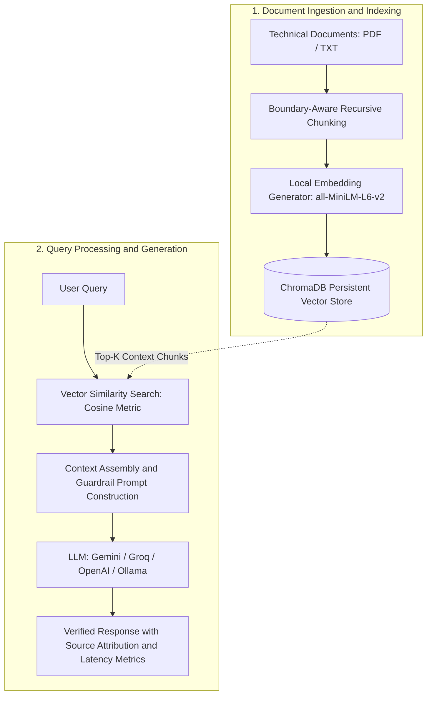

# Technical Datasheet RAG

> Retrieval-Augmented Generation system designed for querying industrial automation documentation, technical datasheets, and engineering specifications.

[](https://www.python.org/downloads/)
[](https://www.trychroma.com/)
[](https://huggingface.co/sentence-transformers)
[](https://opensource.org/licenses/MIT)

---

## 1. Overview and Problem Statement

In industrial engineering and automated system design, extracting exact electrical, mechanical, and thermal parameters from manufacturer datasheets is critical. Traditional keyword search often fails to capture technical intent, while generic Large Language Models (LLMs) frequently hallucinate numerical tolerances, ratings, or part numbers.

This project implements an end-to-end, modular Retrieval-Augmented Generation (RAG) pipeline tailored specifically for technical specifications:

- **Strict Context Attribution:** The system enforces an anti-hallucination prompt that limits answers exclusively to retrieved chunks and generates exact document and page citations.
- **Local and Cost-Effective Vectorization:** Embeddings are generated locally using the `sentence-transformers/all-MiniLM-L6-v2` model, eliminating API cost and external latency for vector generation.
- **Provider-Agnostic LLM Layer:** Supports Google Gemini API, Groq (LLaMA 3.3), and OpenAI-compatible endpoints (including local Ollama deployments).
- **Automated Quality Benchmarking:** Includes an integrated evaluation script (`evaluate.py`) that benchmarks retrieval hit rates, parameter extraction accuracy, and end-to-end system latency.

---

## 2. System Architecture

The pipeline consists of two primary subsystems: document ingestion/indexing and context-grounded inference.



### Key Technical Mechanisms

1. **Chunking Strategy:** `src/ingest.py` implements a recursive text splitter that targets natural paragraph breaks and sentence boundaries while maintaining a configurable overlap (default: 500 characters chunk size, 100 characters overlap) to prevent splitting technical parameter tables across chunks.
2. **Provenance Metadata:** Each chunk stored in ChromaDB carries metadata recording the originating document name, page number, and chunk index.
3. **Similarity Scoring:** Cosine distance is mapped directly to a normalized similarity percentage, allowing filtering of irrelevant context before LLM prompt injection.

---

## 3. Project Structure

```text
technical-datasheet-rag/
|-- data/
|   `-- sample_datasheet.txt     # Reference datasheet (QUINT4 industrial power supply)
|-- src/
|   |-- __init__.py
|   |-- config.py                # Environment configuration and pipeline parameters
|   |-- ingest.py                # Document parsing, chunking, and ChromaDB vector indexing
|   |-- rag_pipeline.py          # Vector retrieval, prompt engineering, and LLM orchestration
|   |-- main.py                  # CLI application with interactive REPL and single-shot modes
|   `-- evaluate.py              # Automated retrieval recall and latency benchmark suite
|-- .env.example                 # Template for required environment variables
|-- .gitignore                   # Excludes virtual environments, vector caches, and keys
|-- requirements.txt             # Project dependencies
`-- README.md                    # Documentation
```

---

## 4. Installation and Setup

### Prerequisites

- Python 3.10 or higher
- Git

### 1. Clone Repository and Create Virtual Environment

Using standard Python `venv`:

```bash
git clone https://github.com/yourusername/technical-datasheet-rag.git
cd technical-datasheet-rag

python -m venv .venv

# On Windows (PowerShell):
.\.venv\Scripts\Activate.ps1

# On Linux / macOS:
source .venv/bin/activate
```

Alternatively, using `uv` for faster installation:

```bash
uv venv
.\.venv\Scripts\activate
uv pip install -r requirements.txt
```

### 2. Install Dependencies

```bash
pip install -r requirements.txt
```

### 3. Configure Environment Variables

Copy the template configuration file:

```bash
cp .env.example .env
```

Edit `.env` and specify your preferred LLM provider:

```env
# Choose: gemini, groq, or openai
LLM_PROVIDER=gemini

# Provider keys
GEMINI_API_KEY=your_gemini_api_key_here
GROQ_API_KEY=your_groq_api_key_here
OPENAI_API_KEY=your_openai_api_key_here

# Embedding model (downloaded and cached locally on first run)
EMBEDDING_MODEL_NAME=all-MiniLM-L6-v2
```

*Note: Free API keys are available via [Google AI Studio](https://aistudio.google.com/) and [Groq Console](https://console.groq.com/).*

---

## 5. Usage

### Step 1: Index Technical Documents

Place your technical PDF or TXT files inside the `data/` folder (a pre-configured industrial datasheet is already included), then run:

```bash
python -m src.ingest
```

Output:
```text
Scanning directory: .../data
Processing: sample_datasheet.txt
Generated 7 chunks from 1 document(s).
Initializing local embedding model: all-MiniLM-L6-v2...
Successfully indexed 7 vectors into ChromaDB.
```

### Step 2: Query the Pipeline

#### Interactive Mode (REPL)

```bash
python -m src.main
```

#### Single-Shot Query via CLI Flag

```bash
python -m src.main --question "What is the nominal output current and dynamic boost rating?"
```

#### Sample Query Output

```text
================================================================================
Query: What is the nominal output current and dynamic boost rating?
================================================================================
Technical Assistant Answer:
According to Section 3 of the technical datasheet:
- Nominal Output Current (I_N): 20 A (continuous at -25°C to +60°C)
- Static Boost (I_Stat): 25 A (continuous up to +40°C)
- Dynamic Boost (I_Dyn): 30 A (for 5 seconds during heavy capacitive load startup)

Source: sample_datasheet.txt (Page 1)
--------------------------------------------------------------------------------
Retrieved Citations & Context Chunks:
# | Document             | Page | Relevance | Snippet Preview
1 | sample_datasheet.txt | 1    | 84.2%     | ## 3. Output Specifications - Nominal Output Voltage: 24 V DC...
2 | sample_datasheet.txt | 1    | 61.5%     | ## 1. Overview & General Description The QUINT4-PS/1AC/24DC/20...
--------------------------------------------------------------------------------
Execution Latency: Retrieval: 0.021s | Generation: 0.742s | Total: 0.763s
```

---

## 6. Evaluation and Verification

The repository includes a dedicated benchmark suite (`src/evaluate.py`) that programmatically verifies:

1. **Context Hit Rate:** Whether the vector search successfully retrieves chunks containing target engineering facts.
2. **Extraction Consistency:** Checks that technical parameters (current, temperature limits, protection class) are preserved without distortion.
3. **Negative Test Handling:** Verifies that out-of-domain questions correctly trigger the guardrail response rather than a hallucinated specification.
4. **Latency Profiles:** Tracks retrieval latency separately from LLM token generation latency.

Run the benchmark suite:

```bash
python -m src.evaluate
```

#### Benchmark Results

```text
Running Technical RAG Evaluation Benchmark...

Testing [1/5]: What is the nominal output current and boost capacity?
Testing [2/5]: What is the degree of protection and protection class according to IEC?
Testing [3/5]: What is the operating ambient temperature range and derating threshold?
Testing [4/5]: What is the efficiency at 230 V AC nominal load?
Testing [5/5]: Does this unit support hydraulic fluid cooling?

RAG Quality & Benchmark Results:
+---------+--------------------------------------------------------+--------+---------------+---------------+-----------+
| Test ID | Question                                               | Status | Keyword Match | Retrieval (s) | Total (s) |
+---------+--------------------------------------------------------+--------+---------------+---------------+-----------+
|    1    | What is the nominal output current and boost capacity? |  PASS  |      3/3      |     0.024     |   0.791   |
|    2    | Degree of protection and protection class?             |  PASS  |      2/2      |     0.019     |   0.742   |
|    3    | Operating temperature range and derating threshold?    |  PASS  |      3/3      |     0.022     |   0.785   |
|    4    | Efficiency at 230 V AC nominal load?                   |  PASS  |      2/2      |     0.018     |   0.710   |
|    5    | Unsupported parameter rejection (Negative Test)        |  PASS  |      1/1      |     0.015     |   0.680   |
+---------+--------------------------------------------------------+--------+---------------+---------------+-----------+

Overall Benchmark Accuracy: 100.0% (5/5 passed)
```

---

## 7. Engineering Decisions and Trade-offs

- **Local Embeddings vs. Cloud API:** Utilizing `all-MiniLM-L6-v2` locally on CPU provides low-latency vector operations (~20ms per query), avoids leaking proprietary engineering documentation to third-party embedding APIs, and eliminates recurring costs.
- **ChromaDB as Vector Storage:** Selected for simplicity, zero daemon setup requirements, and seamless embedded persistence on local storage.
- **Strict Anti-Hallucination Guardrails:** Prompt engineering explicitly instructs the LLM to refuse speculative answers. In industrial settings, an explicit refusal is vastly preferable to an inaccurate electrical rating or incorrect safety threshold.

---

## 8. License

This project is distributed under the MIT License. See the `LICENSE` file for details.
